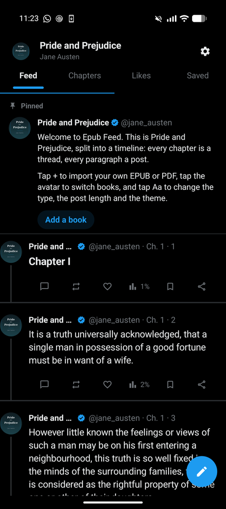
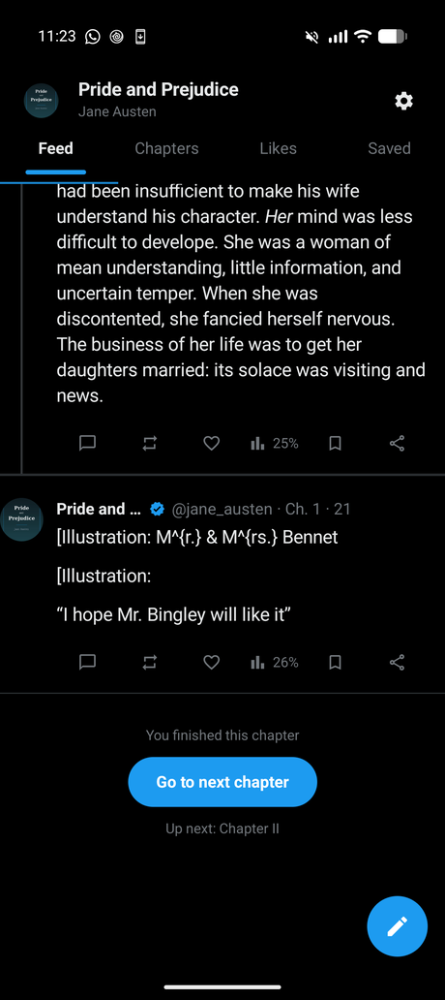
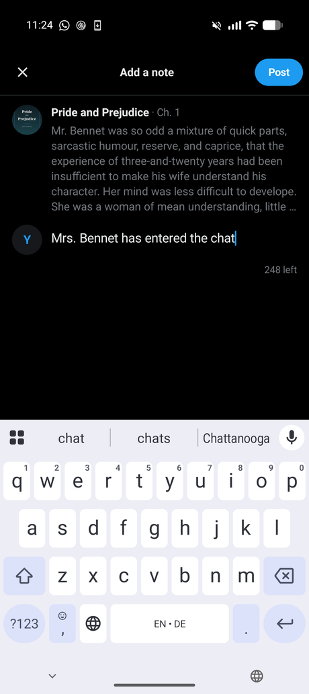
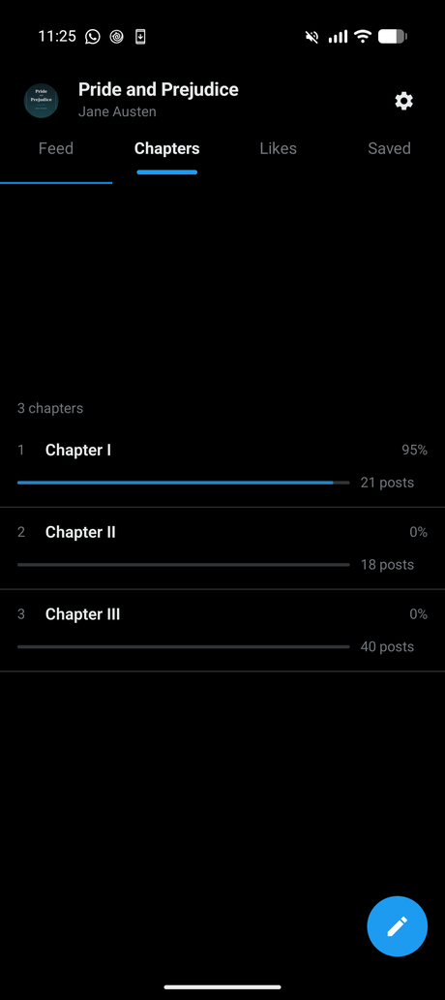
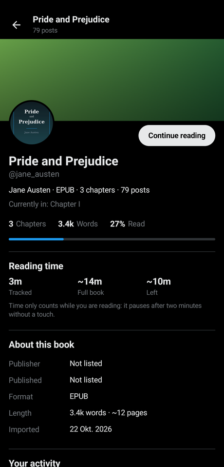

  

<h1 align="center">ePUB Feed</h1>

<strong>Your books, as a timeline.</strong> An offline Android reader that turns EPUB and PDF files into an X style feed.

  <a href="#what-it-does">Features</a> ·
  <a href="#install">Install</a> ·
  <a href="#first-read">First read</a> ·
  <a href="#under-the-hood">Under the hood</a> ·
  <a href="#privacy">Privacy</a>

  
  
  

ePUB Feed is a reading app written in Kotlin with Jetpack Compose. It parses an EPUB or a PDF
on the phone, keeps the book in Room as chapters of source blocks, and renders one chapter as
one feed. The chapter title opens the thread, paragraphs become posts, likes and notes hang off
them, and when the chapter runs out a single blue button takes you to the next one.

**No network permission at all.** A book never leaves the device.

  
  

## What it does

| Feature | What you can do |
| --- | --- |
| **Reading** | Import an EPUB or a PDF and read it as a feed. EPUB is parsed by hand (ZIP, `container.xml`, OPF manifest and spine, XHTML through Jsoup, chapter titles from the EPUB 3 nav document or the EPUB 2 NCX). PDF text comes from pdfbox-android and splits on the outline. The parsed book is stored in Room, so reopening never touches the original file again. |
| **Post length** | Paragraphs are grouped into posts under a character budget when the book is imported. Short, medium or long can be changed later without losing your place, likes or notes. |
| **Notes** | Tap the speech bubble under any post to reply to it. A 280 character composer shows the post you are replying to and the notes already on it, and notes render under the post. |
| **Likes and saves** | Liking pops with haptics. Separate **Likes** and **Saved** tabs list everything, and tapping an entry jumps the feed back to that post. |
| **Chapters you control** | Mark any post as the start of a chapter when detection gets it wrong, or unmark a chapter's first post to fold it back into the one before. Both re-slice the book, keep likes, bookmarks and notes on the same source text, and park the feed on the post you touched. |
| **Your place** | The position is remembered per book and restored on launch, chapter and all, even after the book has been re-sliced. The percentage under a post is measured against the chapter being read, not the book. |
| **Book profile** | Tap the poster's avatar for the cover, title, author, publisher and year from the metadata, chapter, word and post counts, an estimated page count, progress through the book with a bar, and your tracked reading time, likes, saves and notes for that book. Reading time pauses after two minutes without a touch, so a book left open on the table does not inflate it. |
| **Library** | A slide out drawer lists the books on the phone. Drag a book to reorder the library, and the app version sits at the bottom. Swipe between the Feed, Chapters, Likes and Saved tabs. |
| **Look and feel** | Lights out, Dim and Light themes, S, M and L text, serif or sans. |
| **First launch** | **ePUB Feed Basics** is seeded on install, a six chapter book wearing the app icon as its cover that walks through every feature, so the app never opens on an empty screen. `python3 tools/make-sample-epub.py` regenerates it. |

| Notes | Chapters | Profile |
| :---: | :---: | :---: |
|  |  |  |

## Install

There is no store listing yet, so build the debug APK and install it over `adb` on a phone
running Android 8.0 or newer.

| Step | Command |
| --- | --- |
| Get the code | `git clone https://github.com/simisonne/epub-feed.git` |
| Point Gradle at your SDK | `echo "sdk.dir=/path/to/Android/sdk" > local.properties` |
| Build the APK | `./gradlew assembleDebug` |
| Install it | `adb install -r app/build/outputs/apk/debug/app-debug.apk` |
| Run the unit tests | `./gradlew testDebugUnitTest` |

You need JDK 21 and an Android SDK with platform 37 and build tools 36. The tests cover post
generation, EPUB parsing, PDF parsing, image sizing and position restore, and they run on the
JVM, so no device is needed.

## First read

1. Open the drawer and tap **Add book**, or tap the pencil button at the top of the feed, then
   pick an EPUB or a PDF.
2. The app parses it, writes it to Room and opens chapter one as a feed. The source file is not
   needed again.
3. Scroll. The top bar follows the chapter you are in, and the blue button at the end of a
   chapter moves to the next one.
4. Long press a post for the context menu, where a post can become the start of a chapter, and
   long press a chapter in the Chapters tab to unmark it.
5. Close the app whenever you like. Your place is saved as you read and restored on launch,
   down to the post.

## Under the hood

- `data/epub` and `data/pdf` turn a file into chapters of `Block`s (paragraph, quote, heading),
  keeping inline bold and italic runs.
- `domain/PostGenerator` groups blocks into posts under a character budget, never cutting a
  paragraph in half unless it is far over budget, in which case it splits on sentence
  boundaries with an abbreviation aware splitter.
- Room keeps `books`, `chapters` (the source blocks, so posts can be regenerated), `posts`
  (with their source block range), `reactions`, `notes` and `book_stats`.
- Anything the reader attaches to a post is anchored to a **book wide source block offset**,
  which is what lets a chapter split, a chapter merge or a different post length carry likes,
  bookmarks and notes over to the right place.
- The feed is a `LazyColumn` per chapter, so the list index is the post's position in the
  chapter and the reading position is always exact.
- Kotlin, Jetpack Compose (Material 3, heavily rethemed), single activity, Navigation Compose,
  Room, Hilt, Coroutines and DataStore.

## Privacy

Everything stays on the device. The app declares no `INTERNET` permission, has no analytics and
no accounts. Backups are disabled on purpose (`allowBackup="false"`).

## Known limits

- PDF chaptering depends on the PDF having an outline. Without one the whole document becomes a
  single chapter, which is where **Mark as chapter** earns its keep.
- Publisher, year and page counts are read from metadata or estimated at about 275 words per
  page, because EPUBs rarely state real page counts.
- Very large chapters are loaded whole, because a chapter is a feed.

## License

MIT, see [LICENSE](LICENSE).
